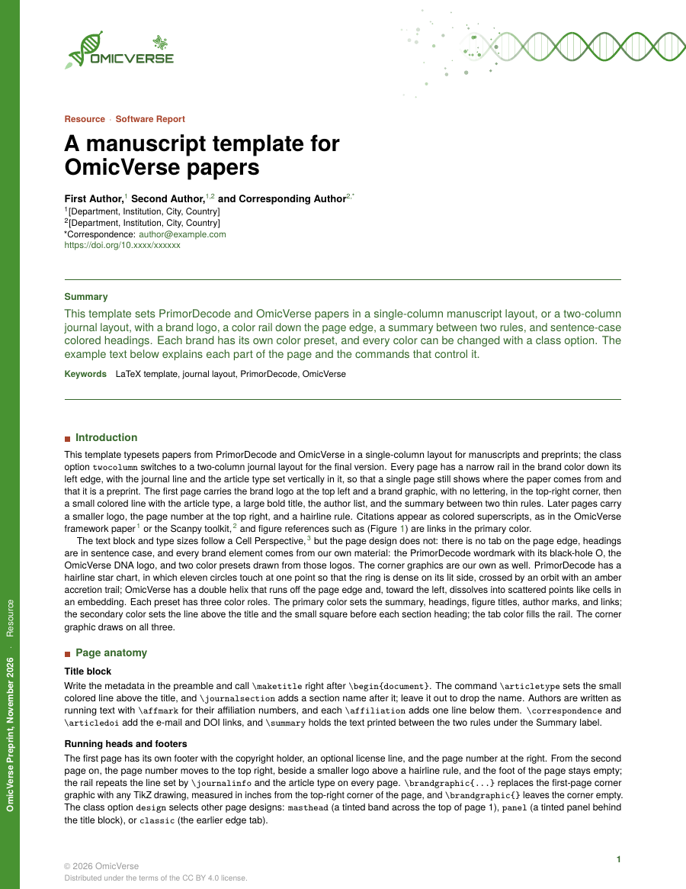
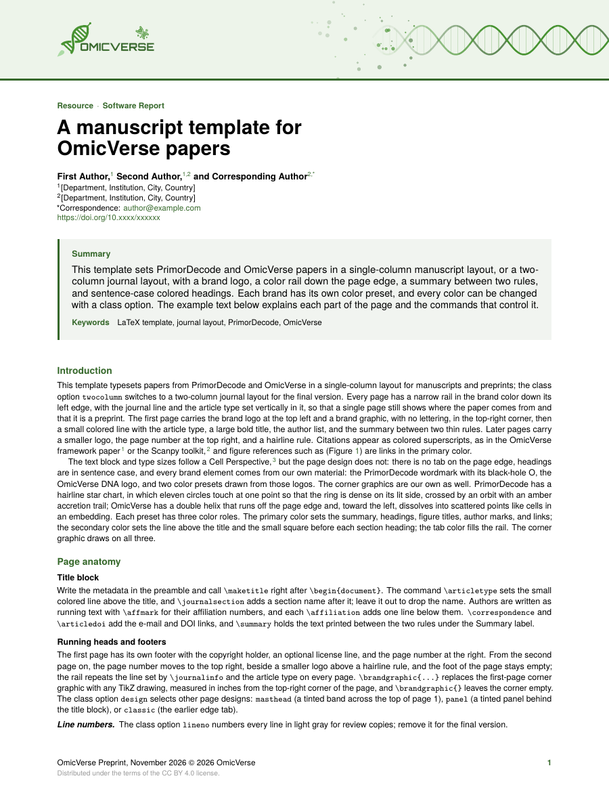
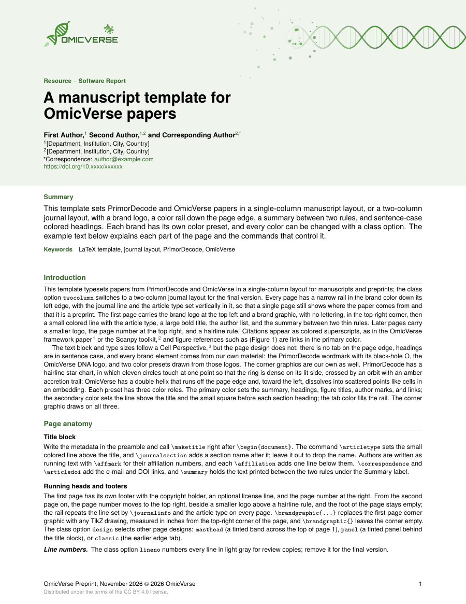
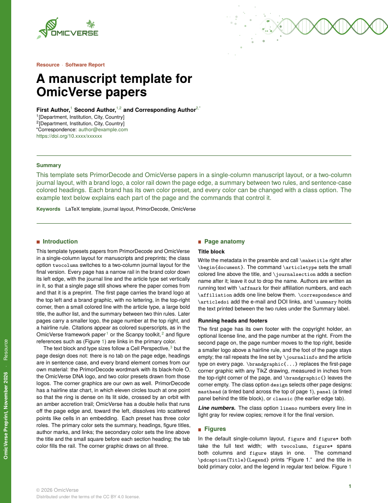
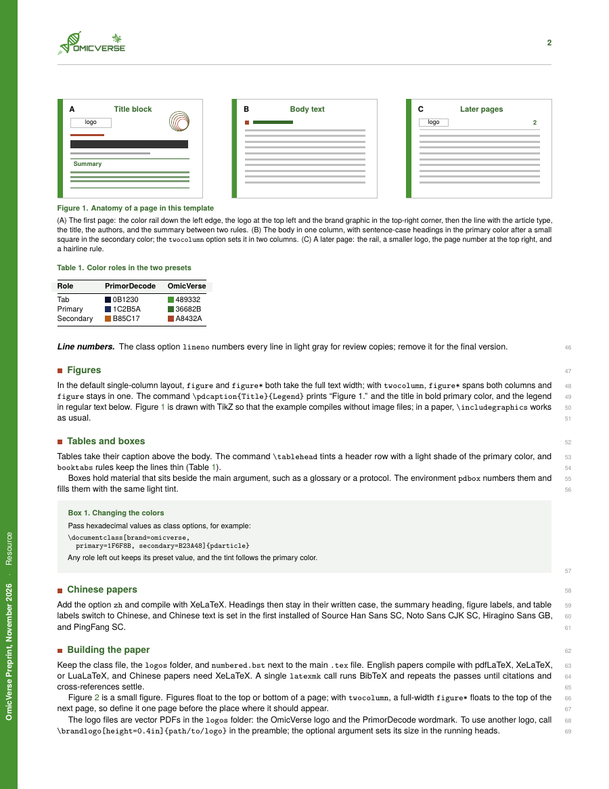
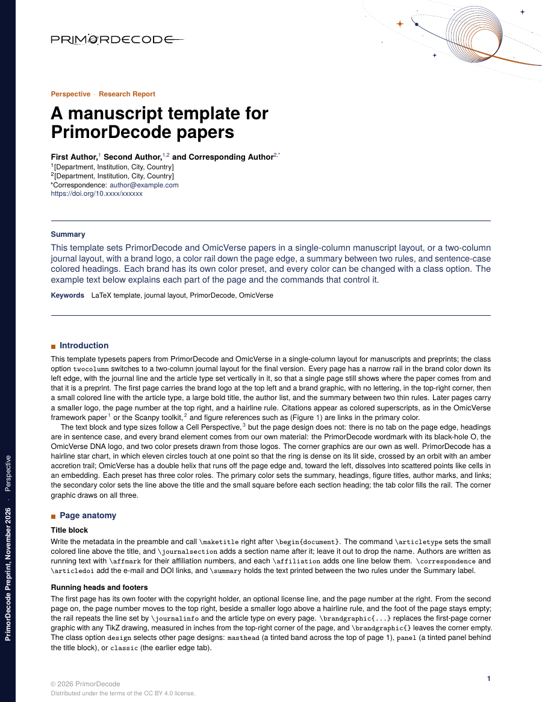
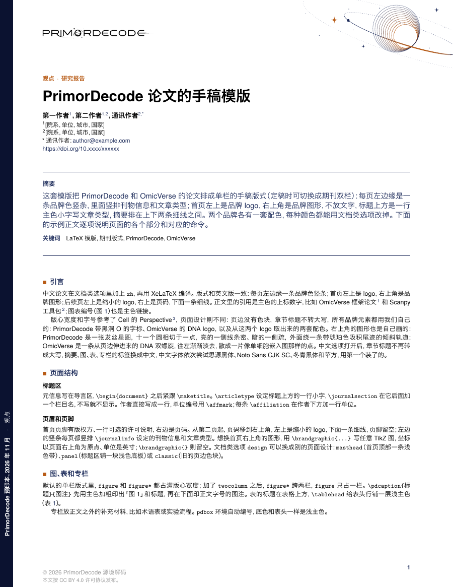

# OmicVerse LaTeX template

[中文说明](README.zh-CN.md)

`pdarticle` is a LaTeX class for OmicVerse papers, preprints and reports. It also has a PrimorDecode brand preset. By default it sets a single-column manuscript; the `twocolumn` option switches to a two-column journal layout for the final version. Page 1 carries the brand logo, a brand graphic, the title block and a summary between two rules. A color rail runs down the left edge of every page.

<p align="center">
  
  
</p>
<p align="center"><sub>Pages 1 and 2 of <code>example-omicverse.tex</code> (default design, <code>design=rail</code>)</sub></p>

## Features

- **Two layouts.** Single-column manuscript by default; `twocolumn` for a journal layout. Both use the same type sizes: body 8.5/11 pt and title 20/21 pt.
- **Four page designs.** `rail` (default), `masthead`, `panel` and `classic`.
- **Two brand presets.** `brand=omicverse` (default) and `brand=primordecode`, each with its own logo, colors and corner graphic. Every color can be changed with a class option.
- **Chinese papers.** The `zh` option, compiled with XeLaTeX.
- **Review copies.** The `lineno` option adds line numbers.
- **Clickable mentions.** `\figlink` makes figure and table mentions clickable. Citations, DOIs and URLs are links in the primary color.
- **Ready-made elements.** Numbered boxes, tinted table heads and figure captions.

## Quick start

1. Download the repository (green **Code** button → **Download ZIP**) or clone it:

   ```bash
   git clone https://github.com/omicverse/omicverse-latex-template.git
   ```

2. Copy `template.tex` and start writing. Keep `pdarticle.cls`, `numbered.bst` and the `logos/` folder next to your main `.tex` file.
3. Compile.
   - English papers work with pdfLaTeX, XeLaTeX or LuaLaTeX:

     ```bash
     latexmk -pdf template.tex
     ```

   - Chinese papers (option `zh`) need XeLaTeX:

     ```bash
     latexmk -xelatex example-zh.tex
     ```

**Overleaf:** upload `pdarticle.cls`, `numbered.bst` and `logos/` together with your `.tex` and `.bib` files. pdfLaTeX works for English; set the compiler to XeLaTeX for `zh`.

A minimal paper:

```latex
\documentclass[brand=omicverse]{pdarticle}

\journalname{OmicVerse}
\articletype{Research Article}
\journalinfo{OmicVerse Preprint, \today}
\copyrightholder{\the\year\ OmicVerse}

\title{Title of the paper}
\author{First Author,\affmark{1} and Last Author\affmark{1,*}}
\affiliation{1}{[Department, Institution, City, Country]}
\correspondence{author@example.com}

\summary{Summary text.}
\keywords{keyword one, keyword two}
\bibliographystyle{numbered}

\begin{document}
\maketitle
\section{Introduction}
Text.\cite{zeng2024omicverse}
\bibliography{example}
\end{document}
```

## Page designs

Pick one with `design=`. Each image below is page 1 of the same example.

<p align="center">
  
  
  
</p>
<p align="center"><sub><code>rail</code> (default) · <code>masthead</code> · <code>panel</code></sub></p>

| Value | What it looks like |
|---|---|
| `rail` (default) | A brand-color rail down the left edge of every page, with the journal line and article type set vertically in it. On page 1 the logo sits at the top left and the brand graphic at the top right. The summary sits between two rules. |
| `masthead` | A full-width tinted band across the top of page 1 holds the logo and the brand graphic. The summary sits in a tinted box. |
| `panel` | A full-width tinted panel sits behind the title block on page 1. Later pages have a thin tinted strip at the top. |
| `classic` | The earlier design: an edge tab that alternates sides and all-caps headings. It is kept for compatibility and not recommended for new papers. |

Later pages in every design show a small logo at the top left, the page number at the top right and a hairline rule.

## Layout and line numbers

<p align="center">
  
  
</p>
<p align="center"><sub><code>twocolumn</code> (page 1) · <code>lineno</code> (page 2)</sub></p>

- `twocolumn` gives two columns with a 13 pt gap. A full-width `figure*` floats to the top of the next page, so define it one page before the place it should appear.
- `lineno` puts small gray line numbers in the right margin in the single-column layout, and on the outer side of each column in the two-column layout.

## Brands

<p align="center">
  
  
</p>
<p align="center"><sub><code>brand=omicverse</code> (default) · <code>brand=primordecode</code></sub></p>

| Role | OmicVerse | PrimorDecode | Used for |
|---|---|---|---|
| `tab` | `489332` | `0B1230` | The rail on the page edge |
| `primary` | `36682B` | `1C2B5A` | Summary and its rules, section headings, figure and table titles, affiliation marks, links and citation numbers |
| `secondary` | `A8432A` | `B85C17` | Article type above the title, the small square before each heading, accents in the corner graphic |

- **Corner graphics.** Both are drawn in TikZ and follow the three colors. The OmicVerse graphic is a DNA double helix that enters from the right edge and fades into a scatter of points, like a single-cell embedding. The PrimorDecode graphic is a hairline star chart with a tilted orbit.
- **Your own colors.** Pass any of the colors as options: `primary=1F6F8B, secondary=B23A48, tab=1F6F8B`. Roles you leave out keep the brand preset. Table heads and box backgrounds follow the primary color.
- **Your own logo.** Use `\brandlogo[height=0.4in]{path/to/logo}`. The optional argument sets the logo's size in the running heads.
- **Your own corner graphic.** Use `\brandgraphic{<TikZ code>}`. Coordinates are in inches from the top-right corner of the page. `\brandgraphic{}` leaves the corner empty.

## Chinese papers

<p align="center">
  
</p>
<p align="center"><sub><code>example-zh.tex</code> (<code>zh</code>, compiled with XeLaTeX)</sub></p>

The `zh` option makes these changes:
- headings are not upper-cased;
- labels become 摘要, 图, 表, 专栏, 通讯作者 and 参考文献;
- line spacing widens by 1.08×.

The CJK font is the first one installed of Source Han Sans SC, Noto Sans CJK SC, Hiragino Sans GB and PingFang SC.

## Class options

```latex
\documentclass[brand=omicverse, design=rail, zh, lineno, twocolumn, a4,
               primary=1F6F8B, secondary=B23A48, tab=1F6F8B]{pdarticle}
```

| Option | Effect |
|---|---|
| `brand=omicverse` (default) / `brand=primordecode` | Logo, color preset, corner graphic and default organization name |
| `design=rail` (default) / `masthead` / `panel` / `classic` | Page design |
| `twocolumn` | Two-column journal layout; without it, single-column manuscript |
| `lineno` | Line numbers for review copies and preprints |
| `zh` | Chinese typesetting (XeLaTeX) |
| `a4` or `paper=a4` | A4 paper instead of US Letter |
| `primary=HEX`, `secondary=HEX`, `tab=HEX` | Override one color role |

## Commands

Preamble:

| Command | Content |
|---|---|
| `\articletype{}` | Small colored line above the title; also on the rail |
| `\journalsection{}` | Section name after the article type (optional) |
| `\journalinfo{}` | Journal line set vertically on the rail |
| `\journalname{}` | Used in the default journal line (name, date) |
| `\copyrightholder{}` | Text after © in the page 1 footer |
| `\licenseline{}` | Optional second footer line on page 1 |
| `\title{}`, `\author{}` | Title and authors; mark affiliations with `\affmark{1,2}`, the corresponding author with `*` |
| `\affiliation{n}{text}` | One line per affiliation |
| `\correspondence{e-mail}`, `\articledoi{DOI}` | Corresponding e-mail and DOI link |
| `\summary{}`, `\keywords{}` | Summary and keywords |
| `\brandlogo[size]{path}`, `\brandgraphic{TikZ}` | Replace the logo or the corner graphic |

Body:

| Command | Content |
|---|---|
| `\pdcaption{Title}{Legend}` | Figure or table caption: "Figure 1." and the title in bold primary color, the legend below; the legend may be empty |
| `\tablehead` | At the start of a table's header row: a light tint of the primary color |
| `\figlink{label}{text}` | A figure or table mention that links to `\label{label}`, e.g. `\figlink{fig:atlas}{Figure 1a}` |
| `\pdanchor{label}` | A link target for a figure or table that has no `\caption` (e.g. the legend sits beside it) |
| `\begin{pdbox}{Title} … \end{pdbox}` | Numbered box (Box 1, Box 2, …); `\begin{pdbox}[breakable]{Title}` for boxes longer than a column |
| `figure*` / `figure` | Full text width in the single-column layout; in `twocolumn`, `figure*` spans both columns and `figure` one column |

To start at another page number, put `\setcounter{page}{101}` before `\maketitle`. That page still gets the page 1 header and footer.

## Type sizes

| Element | Size / leading |
|---|---|
| Body | 8.5 pt / 11 pt |
| Summary | 10 pt / 12 pt, bold |
| Title | 20 pt / 21 pt |
| Article type | 14 pt |
| Authors / affiliations | 9 pt / 8 pt |
| Section headings | 9.5 pt (8.5 pt all caps in `classic`) |
| Figure titles | 7.5 pt |

The margins are 0.8 in left and right, 1.38 in at the top and 0.74 in at the bottom. On Letter paper that gives a 6.9 in text block. The rail and running heads are drawn with `eso-pic` and take no space from the text.

## Files

| File | Purpose |
|---|---|
| `pdarticle.cls` | The class |
| `numbered.bst` | Numbered reference style |
| `logos/omicverse-logo.pdf`, `logos/primordecode-wordmark.pdf` | Brand logos (vector, transparent background) |
| `template.tex` | Blank paper to copy |
| `example-omicverse.tex`, `example-primordecode.tex` | English examples; both use the text in `example-body-en.tex` |
| `example-zh.tex` | Chinese example |
| `example.bib` | Example references |
| `previews/*.tex` | One file per design or option, used for the images above |
| `scripts/build-previews.sh` | Compiles the examples and previews and renders `docs/images/` (needs `latexmk` and `pdftoppm`) |

## License

- **Class and example files:** `pdarticle.cls` and the example and template files may be distributed and modified under the [LaTeX Project Public License](LICENSE), version 1.3c or later.
- **`numbered.bst`:** based on `model6-num-names.bst` from Elsevier's elsarticle bundle, which is also distributed under the LPPL.
- **Logos:** the OmicVerse and PrimorDecode logos in `logos/` belong to their owners. They are included so the template works out of the box and are not covered by the LPPL.
