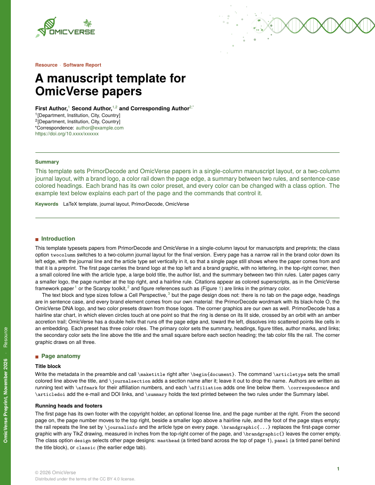
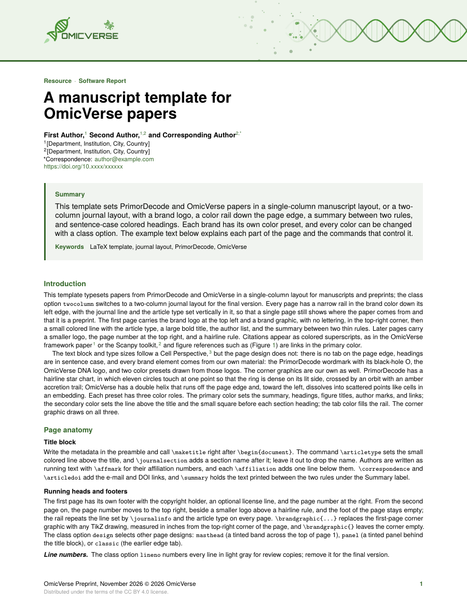
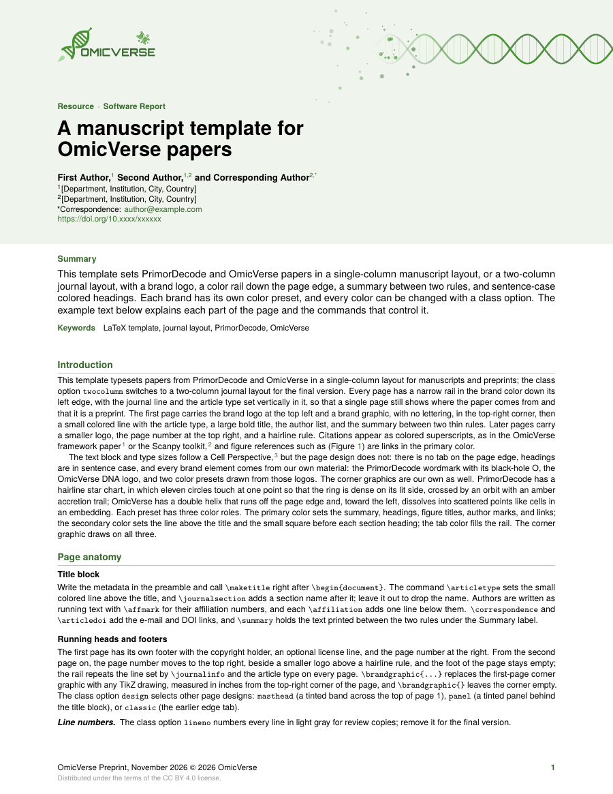
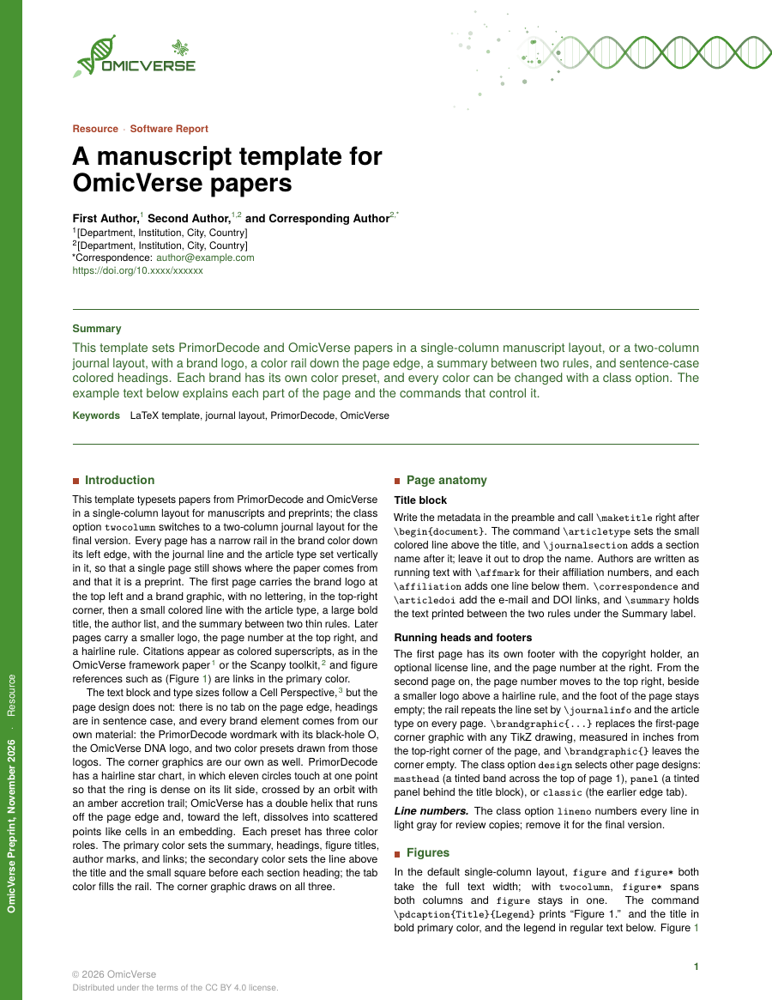
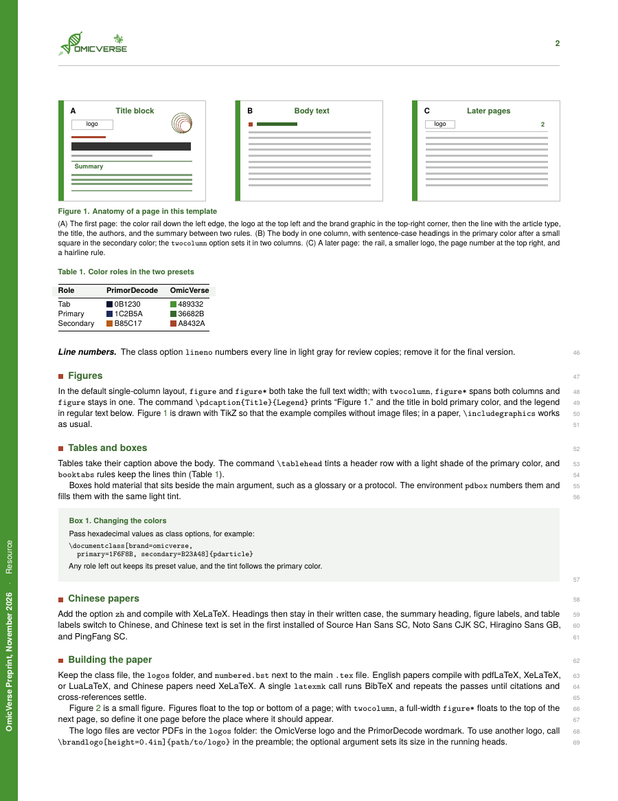
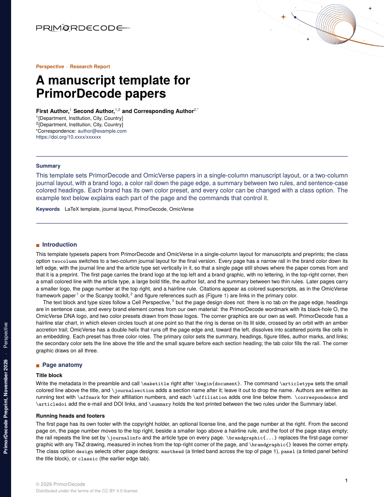
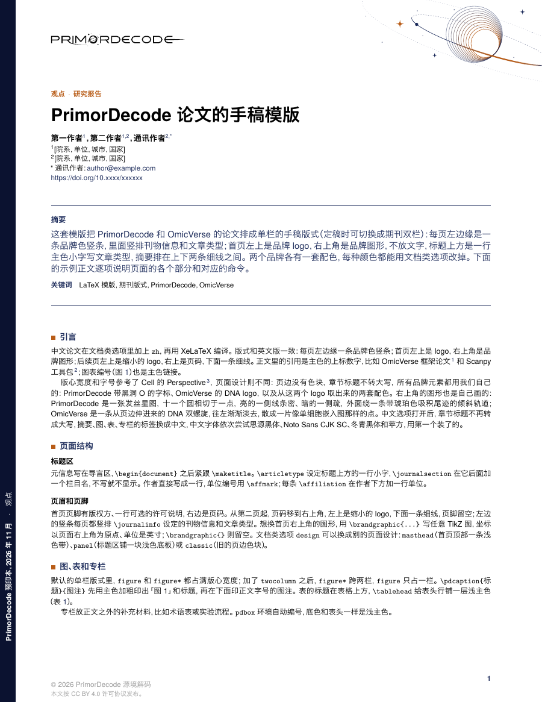

# OmicVerse LaTeX 模版

[English](README.md)

`pdarticle` 是 OmicVerse 论文、预印本和报告用的 LaTeX 文档类，另外带一套 PrimorDecode 品牌预设。默认排成单栏手稿；定稿时加 `twocolumn` 选项，就换成双栏期刊版式。首页有品牌 logo、品牌图形、标题区，以及排在两条细线之间的摘要；每页左边缘都有一条品牌色竖条。

<p align="center">
  
  
</p>
<p align="center"><sub><code>example-omicverse.tex</code> 的第 1、2 页（默认设计 <code>design=rail</code>）</sub></p>

## 特点

- **两种版式**：默认单栏手稿，`twocolumn` 是双栏期刊版式。两者字号相同：正文 8.5/11pt，标题 20/21pt。
- **四种页面设计**：`rail`（默认）、`masthead`、`panel`、`classic`。
- **两套品牌预设**：`brand=omicverse`（默认）和 `brand=primordecode`，各有自己的 logo、配色和角上图形；每种颜色都能用文档类选项改。
- **中文论文**：用 `zh` 选项，XeLaTeX 编译。
- **送审稿**：`lineno` 选项加行号。
- **可点击的提及**：正文里提到图表用 `\figlink`，点了能跳转；引用编号、DOI 和网址本来就是主色链接。
- **现成元素**：自动编号的专栏、浅色表头和图表标题。

## 快速开始

1. 下载仓库（绿色 **Code** 按钮 → **Download ZIP**），或者克隆：

   ```bash
   git clone https://github.com/omicverse/omicverse-latex-template.git
   ```

2. 复制 `template.tex` 开始写。`pdarticle.cls`、`numbered.bst` 和 `logos/` 文件夹要和主 `.tex` 文件放在同一个目录。
3. 编译：
   - 英文论文用 pdfLaTeX、XeLaTeX 或 LuaLaTeX 都可以：

     ```bash
     latexmk -pdf template.tex
     ```

   - 中文论文（`zh` 选项）必须用 XeLaTeX：

     ```bash
     latexmk -xelatex example-zh.tex
     ```

**Overleaf**：把 `pdarticle.cls`、`numbered.bst` 和 `logos/` 连同自己的 `.tex`、`.bib` 一起上传。英文用 pdfLaTeX 即可；`zh` 要把编译器改成 XeLaTeX。

最简单的一篇论文：

```latex
\documentclass[brand=omicverse]{pdarticle}

\journalname{OmicVerse}
\articletype{Research Article}
\journalinfo{OmicVerse Preprint, \today}
\copyrightholder{\the\year\ OmicVerse}

\title{Title of the paper}
\author{First Author,\affmark{1} and Last Author\affmark{1,*}}
\affiliation{1}{[Department, Institution, City, Country]}
\correspondence{author@example.com}

\summary{Summary text.}
\keywords{keyword one, keyword two}
\bibliographystyle{numbered}

\begin{document}
\maketitle
\section{Introduction}
Text.\cite{zeng2024omicverse}
\bibliography{example}
\end{document}
```

## 页面设计

用 `design=` 选择。下面三张都是同一份示例的第 1 页。

<p align="center">
  
  
  
</p>
<p align="center"><sub><code>rail</code>（默认）· <code>masthead</code> · <code>panel</code></sub></p>

| 取值 | 样子 |
|---|---|
| `rail`（默认） | 每页左边缘一条品牌色竖条，里面竖排刊物信息和文章类型；首页左上是 logo，右上角是品牌图形，摘要排在两条细线之间 |
| `masthead` | 首页顶部一条通栏浅色带，里面放 logo 和品牌图形；摘要放在浅色底框里 |
| `panel` | 首页标题区铺一块通栏浅色底板；后续页顶部一条浅色细条 |
| `classic` | 旧版设计：页边色块逐页左右交换，章节标题全大写。为兼容保留，新论文不建议用 |

各种设计的后续页都是左上一个小 logo、右上页码，下面一条细线。

## 版式与行号

<p align="center">
  
  
</p>
<p align="center"><sub><code>twocolumn</code>（第 1 页）· <code>lineno</code>（第 2 页）</sub></p>

- `twocolumn` 排成两栏，栏间距 13pt。跨栏的 `figure*` 会浮动到下一页顶部，要比想放的位置提前一页写。
- `lineno` 加浅灰色小号行号：单栏在右边页边，双栏在每栏外侧。

## 品牌

<p align="center">
  
  
</p>
<p align="center"><sub><code>brand=omicverse</code>（默认）· <code>brand=primordecode</code></sub></p>

| 角色 | OmicVerse | PrimorDecode | 用在哪里 |
|---|---|---|---|
| `tab` | `489332` | `0B1230` | 左边缘竖条 |
| `primary` | `36682B` | `1C2B5A` | 摘要和它上下的细线、章节标题、图表标题、作者单位编号、链接和引用编号 |
| `secondary` | `A8432A` | `B85C17` | 标题上方的文章类型、章节标题前的小方块、角上图形的点缀色 |

- **角上图形**：两套都是 TikZ 画的，跟着三种颜色变色。OmicVerse 是一条 DNA 双螺旋，从页面右边缘伸进来，往左渐渐淡去，散成一片像单细胞嵌入图那样的点；PrimorDecode 是发丝细线的星图，外面绕一条倾斜的轨道。
- **自己的颜色**：用选项传任意一种颜色，例如 `primary=1F6F8B, secondary=B23A48, tab=1F6F8B`。没写的颜色保留品牌预设；表头和专栏的浅色底跟着主色变。
- **自己的 logo**：用 `\brandlogo[height=0.4in]{路径}`，可选参数是页眉里 logo 的尺寸。
- **自己的角上图形**：用 `\brandgraphic{TikZ 代码}`，坐标以页面右上角为原点、单位是英寸；`\brandgraphic{}` 则留空。

## 中文论文

<p align="center">
  
</p>
<p align="center"><sub><code>example-zh.tex</code>（<code>zh</code>，XeLaTeX 编译）</sub></p>

`zh` 选项会做这些改动：
- 标题不转大写；
- 标签改成摘要、图、表、专栏、通讯作者、参考文献；
- 行距放宽 1.08 倍。

中文字体按思源黑体 SC → Noto Sans CJK SC → 冬青黑体（Hiragino Sans GB）→ 苹方的顺序，取第一个已安装的。

## 文档类选项

```latex
\documentclass[brand=omicverse, design=rail, zh, lineno, twocolumn, a4,
               primary=1F6F8B, secondary=B23A48, tab=1F6F8B]{pdarticle}
```

| 选项 | 作用 |
|---|---|
| `brand=omicverse`（默认）/ `brand=primordecode` | logo、配色预设、角上图形和默认机构名 |
| `design=rail`（默认）/ `masthead` / `panel` / `classic` | 页面设计 |
| `twocolumn` | 双栏期刊版式；不写就是单栏手稿 |
| `lineno` | 行号，送审稿和预印本用 |
| `zh` | 中文排版（XeLaTeX） |
| `a4` 或 `paper=a4` | A4 纸（默认 US Letter） |
| `primary=HEX`、`secondary=HEX`、`tab=HEX` | 单独改某一种颜色 |

## 命令

导言区：

| 命令 | 内容 |
|---|---|
| `\articletype{}` | 标题上方的彩色小字，也竖排在竖条里 |
| `\journalsection{}` | 栏目名，接在文章类型后面（可不写） |
| `\journalinfo{}` | 竖排在竖条里的刊物信息 |
| `\journalname{}` | 只在默认刊物信息（刊物名, 日期）里用到 |
| `\copyrightholder{}` | 首页页脚 © 后面的文字 |
| `\licenseline{}` | 首页页脚第二行（可空） |
| `\title{}`、`\author{}` | 标题与作者；单位编号用 `\affmark{1,2}`，通讯作者加 `*` |
| `\affiliation{编号}{单位}` | 每条一行 |
| `\correspondence{邮箱}`、`\articledoi{DOI}` | 通讯邮箱和 DOI 链接 |
| `\summary{}`、`\keywords{}` | 摘要、关键词 |
| `\brandlogo[尺寸]{路径}`、`\brandgraphic{TikZ}` | 换 logo 或角上图形 |

正文：

| 命令 | 内容 |
|---|---|
| `\pdcaption{标题}{图注}` | 图表标题：「Figure 1.」和标题用主色加粗，图注在下一行；图注可留空 |
| `\tablehead` | 写在表头行开头，铺浅主色 |
| `\figlink{标签}{文字}` | 提到图表时用，点了跳到 `\label{标签}`，例如 `\figlink{fig:atlas}{Figure 1a}` |
| `\pdanchor{标签}` | 没有 `\caption` 的图表（比如图注放在旁边）用它当跳转目标 |
| `\begin{pdbox}{标题} … \end{pdbox}` | 自动编号的专栏（专栏 1、专栏 2……）；超过一栏长的用 `\begin{pdbox}[breakable]{标题}` |
| `figure*` / `figure` | 单栏版式里都占满版心宽度；双栏版式里 `figure*` 跨两栏，`figure` 占一栏 |

要从别的页码开始，把 `\setcounter{page}{101}` 写在 `\maketitle` 前面，这一页仍然用首页的页眉和页脚。

## 字号与行距

| 元素 | 字号 / 行距 |
|---|---|
| 正文 | 8.5pt / 11pt |
| 摘要 | 10pt / 12pt，加粗 |
| 标题 | 20pt / 21pt |
| 文章类型 | 14pt |
| 作者 / 单位 | 9pt / 8pt |
| 章节标题 | 9.5pt（`classic` 为全大写 8.5pt） |
| 图题 | 7.5pt |

左右页边距各 0.8in，上 1.38in、下 0.74in，Letter 纸上版心宽 6.9in。竖条和页眉由 `eso-pic` 画在页面上，不占正文高度。

## 文件

| 文件 | 用途 |
|---|---|
| `pdarticle.cls` | 文档类本体 |
| `numbered.bst` | 编号制参考文献样式 |
| `logos/omicverse-logo.pdf`、`logos/primordecode-wordmark.pdf` | 品牌 logo（矢量、透明底） |
| `template.tex` | 空白论文，复制后直接写 |
| `example-omicverse.tex`、`example-primordecode.tex` | 英文示例，正文共用 `example-body-en.tex` |
| `example-zh.tex` | 中文示例 |
| `example.bib` | 示例参考文献 |
| `previews/*.tex` | 每种设计或选项一个文件，用来生成上面的图 |
| `scripts/build-previews.sh` | 编译示例和预览，生成 `docs/images/`（需要 `latexmk` 和 `pdftoppm`） |

## 许可

- **文档类和示例文件**：`pdarticle.cls` 及示例、模版文件按 [LaTeX Project Public License](LICENSE) 1.3c 或更高版本发布和修改。
- **`numbered.bst`**：基于 Elsevier elsarticle 包里的 `model6-num-names.bst`，同样以 LPPL 发布。
- **logo**：`logos/` 里的 OmicVerse 和 PrimorDecode logo 归各自所有者，放在这里是为了让模版开箱即用，不在 LPPL 范围内。
